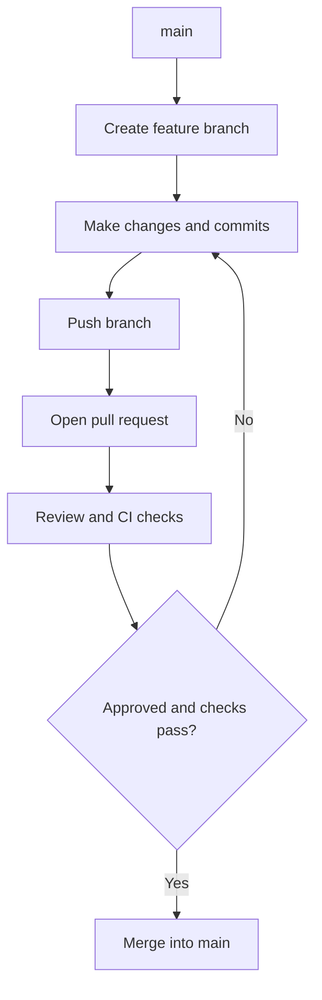

# Day 1: Git & GitHub Foundations

**Date:** 2026-10-22  
**Author:** Giridhar  
**Sprint / Phase:** Day 1 — Repository Initialization, Git Hygiene & GitHub Collaboration  
**Goal:** Learn and practise Git branching, atomic Conventional Commits, pull requests, code reviews, CI automation, conflict resolution drills, interactive rebasing, and safe recovery.

---

## 1. Git Workflow Architecture

The standard feature-branch and pull request lifecycle adopted for TaskFlow:



---

## 2. Git Commands Practised & Learned

| Command | Purpose |
|---|---|
| `git status` | Inspect working directory and staged changes |
| `git branch -a` | List all local and remote tracking branches |
| `git remote -v` | Verify configured remote URLs (`origin`) |
| `git log -n 5 --oneline` | Review recent commit history in compact format |
| `git config --get user.name` / `user.email` | Verify local or global author identity |
| `git branch -m <name>` | Rename current working branch cleanly |
| `git add <files>` | Stage specific files for an atomic commit |
| `git diff` / `git diff --staged` | Inspect changes before creating a commit |
| `git commit -m "..."` | Record atomic changes following Conventional Commits format |
| `git push -u origin <branch>` | Push local branch and set upstream tracking |
| `git rebase <base-branch>` | Replay commits on top of another base branch |
| `git rebase --continue` | Resume rebase after resolving conflict markers and staging |
| `git rebase -i HEAD~N` | Interactively squash, reword, edit, or drop past commits |
| `git branch -D <branch>` | Force delete a disposable practice or merged branch |

---

## 3. Branch, Commit, PR, Review & Merge Workflow

1. **Branch Naming Conventions:**
   - `feat/`: User-facing features and functionality.
   - `fix/`: Bug fixes and hotfixes.
   - `chore/`: Build configuration, scaffolding, and maintenance (e.g. `chore/project-skeleton`).
   - `docs/`: Documentation additions and edits.
2. **Atomic & Conventional Commits:**
   - Commits are focused on single logical changes.
   - Standard format: `<type>(<scope>): <subject>` (e.g., `chore(repo): add project skeleton`, `fix(build): track frontend api helper and unignore src/lib in .gitignore`).
3. **Pull Request Hygiene:**
   - Kept pull requests structured and traceable.
   - Standardized template (`.github/pull_request_template.md`) with Summary, Changes, How to test, and Checklist.
   - Protected `main` by requiring PR review and passing CI builds.

### Pull Request & Merge Record
- **Pull Request:** [PR #2: Chore/project skeleton](https://github.com/itsmegiridhar05-spec/taskflow/pull/2)
- **Review Feedback:** [PR #2 Senior Engineer Review Comment](https://github.com/itsmegiridhar05-spec/taskflow/pull/2#issuecomment-6334594220)
- **CI Workflow Run:** [Run #39735880976 (100% Passed)](https://github.com/itsmegiridhar05-spec/taskflow/actions/runs/39735880976)
- **Merge Commit SHA:** `70e74cd0626d6fd8a0641a75742f9ac25a4c7fa1` into `main`

---

## 4. Conflict Resolution & Interactive Rebase Exercises

### Exercise A: Merge Conflict Resolution Drill
- **Branch:** Created disposable branches `practice/conflict-drill` and `temp/conflict-target` off `main`.
- **Simulation:** Modified line 1 of `README.md` simultaneously on both branches:
  - Branch 1: `# TaskFlow — Developer Practice Branch`
  - Branch 2: `# TaskFlow — Upstream Main Branch`
- **Trigger:** Ran `git rebase temp/conflict-target`, producing:
  ```
  Auto-merging README.md
  CONFLICT (content): Merge conflict in README.md
  error: could not apply eec5286... test(drill): update title on practice branch
  ```
- **Conflict Markers Encountered:**
  ```markdown
  <<<<<<< HEAD
  # TaskFlow — Upstream Main Branch
  =======
  # TaskFlow — Developer Practice Branch
  >>>>>>> eec5286 (test(drill): update title on practice branch)
  ```
- **Resolution:** Removed conflict markers and merged cleanly into:
  `# TaskFlow — Enterprise-Ready Modern Agile Task Management`
- **Completion:** Staged via `git add README.md` and finalized with `git rebase --continue`.
- **Cleanup:** Switched to `main` and deleted both disposable branches (`git branch -D`).

### Exercise B: Interactive Rebase (`git rebase -i`) Drill
- **Branch:** Created disposable branch `practice/rebase-drill`.
- **Simulation:** Created 3 consecutive dummy commits:
  1. `785ce4f feat(drill): add initial draft of drill notes`
  2. `3dd7ac9 wip: typo fix in notes` (messy WIP commit)
  3. `cc4191a docs: add section 2` (non-conventional commit message)
- **Rebase Operations:**
  - `pick 785ce4f`
  - `fixup 3dd7ac9` (squashed typo fix directly into initial commit, discarding messy commit message)
  - `reword cc4191a` (rewrote to `docs(drill): expand drill documentation with section 2`)
- **Outcome:** Clean, linear, professional history verified via `git log --oneline -n 5`:
  ```
  2d9bb3c docs(drill): expand drill documentation with section 2
  98a2185 feat(drill): add initial draft of drill notes
  70e74cd Merge pull request #2 from itsmegiridhar05-spec/chore/project-skeleton
  ```
- **Cleanup:** Switched back to `main` and deleted `practice/rebase-drill`.

---

## 5. Problems Encountered & Root-Cause Solutions

### Problem 1: Frontend Build Failure in GitHub Actions CI
- **Symptoms:** `Backend Tests & Validation` passed in 16s, but `Frontend Lint & Build` failed after 27s during `npm run build`.
- **Diagnosis:** Inspection of the raw CI log revealed:
  ```
  ./src/components/TaskDashboard.tsx
  Module not found: Can't resolve '@/lib/api'
  ```
- **Root Cause:** In the root `.gitignore`, `lib/` was written without a leading anchor slash. Git treated this as a glob pattern matching any directory named `lib` at any depth, ignoring `frontend/src/lib/api.ts` from being staged and pushed.
- **Solution:**
  1. Updated `.gitignore` to use `/lib/` and `/lib64/` (anchored strictly to the root).
  2. Staged and committed `frontend/src/lib/api.ts` with commit message `fix(build): track frontend api helper and unignore src/lib in .gitignore`.
  3. Pushed to remote; triggered workflow run #39735880976 which passed with green checkmarks on all jobs.

### Problem 2: Git Identity Missing Locally
- **Symptoms:** Initial commits risked missing user attribution.
- **Solution:** Configured `git config user.name "Giridhar"` and `git config user.email "itsmegiridhar05@gmail.com"`.

### Problem 3: Branch Naming Realignment
- **Symptoms:** Branch initially created as `feature/initial-setup` instead of Day 1's required `chore/project-skeleton`.
- **Solution:** Renamed branch with `git branch -m chore/project-skeleton` before publishing.

---

## 6. Tests & Verification Summary

| Test / Check | Tooling | Result |
|---|---|---|
| **Backend Tests** | `pytest tests/test_health.py` | 3 passed (100%) |
| **Frontend Linter** | `npm run lint` (`eslint`) | 0 errors, 0 warnings |
| **Frontend Production Build** | `npm run build` (`next build`) | Compiled successfully with Turbopack |
| **CI Automation** | GitHub Actions (`ubuntu-latest`) | Both jobs green on PR #2 |
| **Conflict Drill** | `git rebase` + manual resolution | Verified clean working tree |
| **Interactive Rebase** | `git rebase -i HEAD~3` | Squashed & reworded cleanly |

---

## 7. What I Learned & Day 1 Conclusion

- **Core Principles Mastered:**
  - **Git as a Team Ledger:** Commits are permanent history and should be atomic, purposeful, and well-described.
  - **PRs as Quality Gates:** Pull requests are not merely merge triggers; they are where automated CI, code review discussions, and validation happen before code reaches production (`main`).
  - **Conflict Confidence:** Merge conflicts are normal in collaborative software development. By reading conflict markers (`<<<<<<<`, `=======`, `>>>>>>>`) calmly and understanding which change comes from which commit, any conflict can be resolved cleanly.
  - **History Hygiene with Rebase:** Intermediate messy commits ("wip", "typo fix") should be squashed or fixed up before sharing code upstream.
- **Day 1 Status:** **100% Complete**. All code, documentation, CI workflows, and drills are finalized, tested, and merged into `main`.
