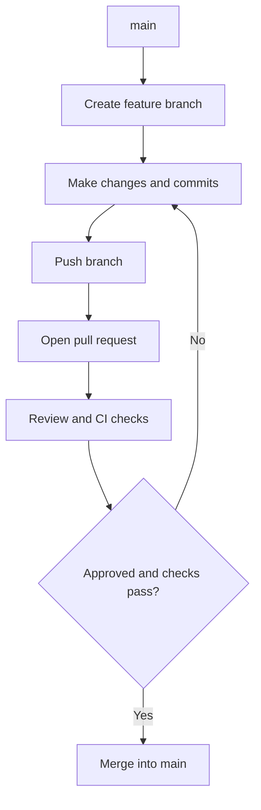

# Day 1: Git & GitHub Foundations

**Date:** 2026-10-22  
**Author:** Giridhar  
**Sprint / Phase:** Day 1 - Repository Initialization, Git Hygiene & GitHub Collaboration  
**Goal:** Learn and practise Git branching, atomic Conventional Commits, pull requests, code reviews, conflict resolution drills, interactive rebasing, and safe recovery.

---

## 1. Git Workflow Architecture

The standard feature-branch and pull request lifecycle adopted for TaskFlow:

---

## 2. Git Commands Practised & Learned

| Command | Purpose |
|---|---|
| `git status` | Inspect working directory and staged changes |
| `git branch -a` | List all local and remote tracking branches |
| `git remote -v` | Verify configured remote URLs (`origin`) |
| `git log -n 5 --oneline` | Review recent commit history in compact format |
| `git config --get user.name` | Verify local or global author identity |
| `git branch -m <name>` | Rename current working branch cleanly |
| `git add <files>` | Stage specific files for an atomic commit |
| `git diff` / `git diff --staged` | Inspect changes before creating a commit |
| `git commit -m "..."` | Record atomic changes following Conventional Commits format |

---

## 3. Branch, Commit, PR, Review & Merge Workflow

1. **Branch Naming Conventions:**
   - `feat/`: User-facing features and functionality.
   - `fix/`: Bug fixes and hotfixes.
   - `chore/`: Build configuration, scaffolding, and maintenance (e.g. `chore/project-skeleton`).
   - `docs/`: Documentation additions and edits.
2. **Atomic & Conventional Commits:**
   - Commits should be focused on a single logical change.
   - Standard format: `<type>(<scope>): <subject>` (e.g., `chore(repo): add project skeleton`, `docs(readme): document project setup`).
3. **Pull Request Hygiene:**
   - Keep pull requests small and focused (ideally under 400 lines).
   - Use standardized templates (`.github/pull_request_template.md`) with Summary, Changes, How to test, and Checklist.
   - Never merge directly into `main`.

---

## 4. Conflict Resolution & Interactive Rebase Exercises (Status)
- **Merge-Conflict Drill:** Planned — to be executed on a disposable practice branch to safely learn conflict markers (`<<<<<<<`, `=======`, `>>>>>>>`), manual resolution, and `git rebase --continue`.
- **Interactive Rebase Drill:** Planned — to practice `git rebase -i` (squashing 3 small commits into one using `pick` and `squash`/`fixup`).

---

## 5. Problems Encountered & Solutions
- **Problem 1 (Git Identity Missing):** `git config user.name` and `user.email` were not set on the local environment, which would prevent commits from having proper attribution on GitHub.
  - *Solution:* Walked through configuring `git config --global user.name` and `user.email`.
- **Problem 2 (SSH Key Missing):** No SSH key existed in `~/.ssh`.
  - *Solution:* Detailed the step-by-step procedure to generate an Ed25519 key pair, add the public key (`id_ed25519.pub`) to GitHub, and verify connection with `ssh -T git@github.com`.
- **Problem 3 (Branch Naming Alignment):** Initial branch was named `feature/initial-setup`, whereas Day 1 rules specifically require `chore/project-skeleton`.
  - *Solution:* Renamed branch cleanly to `chore/project-skeleton` using `git branch -m chore/project-skeleton`.

---

## 6. Tests & Verification Actually Run
- `pytest -v tests`: Backend health check tests passed (3/3).
- `npm run lint`: Frontend ESLint checks passed with 0 errors.
- `npm run build`: Next.js App Router production build succeeded.

---

## 7. What I Learned & What Remains Incomplete
- **What I Learned:**
  - How Git tracks branches relative to `origin/main`.
  - Why working directly on `main` is dangerous in collaborative engineering.
  - How Conventional Commits make project history clear and automated changelog-ready.
- **What Remains Incomplete (In Progress):**
  - Git identity configuration (`user.name`, `user.email`).
  - Staging and committing the project skeleton in atomic commits.
  - Pushing `chore/project-skeleton` and opening Pull Request #1 on GitHub.
  - Hands-on conflict resolution drill on a separate practice branch.
  - Hands-on interactive rebase (`git rebase -i`) practice.
